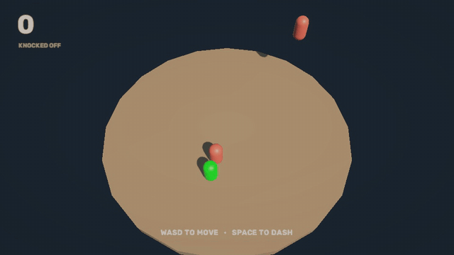
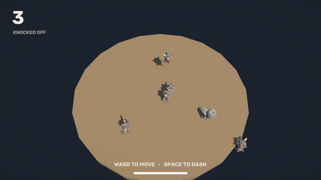
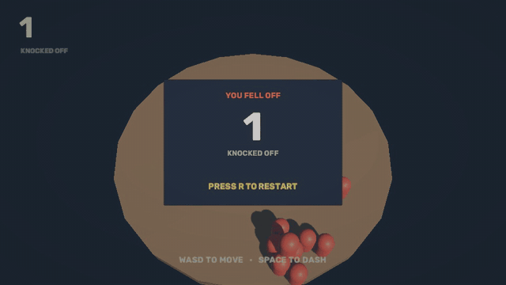

# Ring Out

## About the game

A 3D arena game made in Unity 6. You stand on a round platform and enemies drop in and push toward you. You have no weapon. Your dash is your attack and your dodge, on the same button.

If your dash hits an enemy, it gets knocked off the edge. If you miss, the dash can carry you off the edge yourself. Your score is how many enemies you knock off.

- **Controls:** WASD to move, Space to dash, R to restart
- **Engine:** Unity 6 (6000.6.0f1), URP
- **Time:** 2 days (28 to 29 September 2026), solo

## Gameplay

<table>
  <tr>
    <td width="50%" valign="top"> Dashing into an enemy knocks it off the edge</td>
    <td width="50%" valign="top"> Enemies drop in and crowd you</td>
  </tr>
  <tr>
    <td width="50%" valign="top"> A risky dash toward the edge carries you off</td>
    <td width="50%" valign="top"> R starts a new round</td>
  </tr>
</table>

## Features

- Enemies chase you by pushing toward your position with physics forces.
- Dash with a cooldown. An enemy only gets knocked back if you hit it right after a dash.
- Anything that falls below the platform is out: an enemy gives you +1, and you falling ends the game.
- Camera shake on every hit, a dash trail, and slow motion on game over.
- I tuned it by playing: knock power 5 to 20, dash cooldown 2 s to 0.5 s, chase force 3 to 10.

## My contribution

- I wrote the player and enemy scripts. I reused my GameManager from Wobble Tower and my spawner and camera shake from Hole in the Wall, and changed them to fit this game.
- Claude (an AI assistant) set up the scene, UI and look, and gave me a first version of the knockback code. I typed it and changed it to use my own dash cooldown.

## Architecture

| Script | What it does |
|:-|:-|
| `PlayerMovement.cs` | Moving, the dash and its cooldown, the knockback, checking if you fell off |
| `EnemyChase.cs` | On every enemy: pushes it toward the player, gives a point when it falls off |
| `EnemySpawner.cs` | Drops an enemy at a random spot every 2 seconds (reused from Hole in the Wall) |
| `GameManager.cs` | Score, slow motion game over, restart (reused from Wobble Tower) |
| `CameraShake.cs` | Shakes the camera for a moment (reused from Hole in the Wall) |

How the scripts connect:

- 3 of the 5 scripts came from my earlier games with small changes. That's the main reason this game took 2 days and my first one took 8.
- `GameManager` and `CameraShake` are singletons, so the player and enemies can use them without references.
- Every enemy handles its own chasing and its own scoring, so the spawner just creates them and forgets about them.

What I'd change: the knockback lives inside `PlayerMovement`, and I'd move it into its own script. Every enemy also finds the player with `GameObject.Find("Player")`, which breaks if the player gets renamed. It would be better if the spawner passed the player in.

## How to open it

1. Open the project with Unity 6 (6000.6.0f1).
2. Open `Assets/Scenes/SampleScene.unity` and press Play.

## Credits

- Font: Rubik (SIL Open Font License, the license file is in `Assets/Fonts`).
